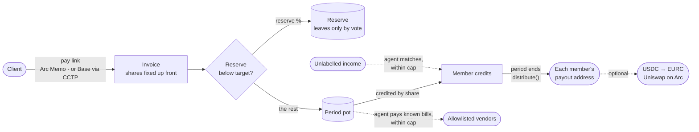

<div align="center">


# Keyarc

**Your team's payment link, on Arc.**

Clients pay one link. The money lands in the team's chest, a reserve goes aside first,<br/>
and everyone is paid by the shares written on the invoice. Rules change only by vote.

[**Live app**](https://keyarc.app) · [Demo chest](https://keyarc.app/c/0xd612E26C268375d7ec80FeC3c35623Db9E58aa2c) · [Contracts](contracts/src) · [Agent](agent/src) · [Mainnet addresses](deployments/arc-mainnet.json)


</div>

---

## Contents

- [The problem](#the-problem)
- [What Keyarc does](#what-keyarc-does)
- [How a payment moves](#how-a-payment-moves)
- [The treasury agent](#the-treasury-agent)
- [Live on Arc mainnet](#live-on-arc-mainnet)
- [Why Arc](#why-arc)
- [Security model](#security-model)
- [Repository map](#repository-map)
- [Run it locally](#run-it-locally)
- [For reviewers](#for-reviewers)
- [Status and roadmap](#status-and-roadmap)

## The problem

Small teams that bill clients together (a developer in İstanbul, a designer in Berlin, a copywriter in Lisbon) almost always get paid the same way: **the client pays one person, and that person forwards everyone's share by hand.**

That one person becomes the team's bank. They carry the tax and trust risk for money that isn't theirs. Shares get argued about after the money has landed. Partial transfers go missing ("sent 1,000, the rest?"). Nobody sets a reserve aside, so the first slow month hurts everyone. And each member wants to be paid differently: one keeps USDC, another wants euros.

## What Keyarc does

Keyarc replaces "pay me and I'll forward it" with a **payment link backed by a contract that belongs to the whole team.**

| | Today | With Keyarc |
|---|---|---|
| Who receives the money | One member's wallet | The team's chest (a contract) |
| When shares are decided | After the money arrives | On the invoice, **before** the client pays |
| The reserve | Whatever is left | Filled first, up to a target; leaves only by vote |
| Paying everyone | Manual transfers, one by one | One `distribute()` at period end |
| Where each share lands | Wherever the collector sends it | Each member picks their own payout address |
| Changing the rules | Whoever holds the wallet | Member vote + timelock |
| Bookkeeping | A spreadsheet | An agent that works inside limits the contract enforces |

**The flow in the app** (`/app/bill`):

1. Write what the team delivered, the amount, and who did the work with their share.
2. The first invoice opens the team chest and pins the invoice in two signatures. Later invoices take one.
3. Send the client the pay link. They pay in USDC **on Arc** or **from Base** (CCTP fast transfer). No account and no Keyarc token.
4. When the money lands, the reserve and every share are set aside automatically. At period end everyone is paid.
5. Each member sees their earnings across teams (`/app/earnings`), exports them as CSV or PDF, chooses where their share is paid, and can convert USDC to **EURC on Arc** in one step.

## How a payment moves



- **Invoice ids can't be squatted.** An id is `keccak(chest, creator, salt)`, and payment must match the expected amount.
- **On Arc** the client approves exactly the invoice amount and pays through Arc's **Memo** contract, so the invoice id sits in Arc's own memo log while the payer stays `msg.sender`.
- **From Base** the client burns USDC with **CCTP v2 fast transfer**, with the chest as mint recipient. The agent relays Circle's attestation and matches the inflow to the invoice.
- **One member can't block a payout.** If a transfer fails (for example a USDC blocklist), everyone else is still paid and the failed share is held for `claim(to)`.
- **Payout addresses** (v3): `setPayoutAddress(to)` lets a member send their share to another wallet or an exchange deposit address on Arc.

## The treasury agent

A Cloudflare Worker that does the team's bookkeeping. For anything that needs judgement it asks **Claude Haiku 5.5** (`claude-haiku-5-5`) with structured outputs. **The model reads and gives an opinion; code decides; the contract sets the limits.**

| Job | What it does | What must be true before money moves |
|---|---|---|
| **Collections** | Scans USDC inflows and matches each to an open invoice. | The rules find exactly one invoice the inflow pays (exact amount, at most 0.5% over), **and** the model agrees with ≥ 80% confidence, **and** the amount is within the period cap, **and** the funds are in the chest. Over the cap → it becomes a vote. Otherwise → **held** for members. |
| **Payables** | Reads vendor bills (email or upload, PDFs included), screens them for fraud, pays them. | Vendor is in the members' registry; currency is right; amount ≤ vendor max and ≤ 3× their usual bill; invoice number never paid before; payment details unchanged; no pressure or hidden instructions in the bill; payee is on the on-chain allowlist; amount within cap. Any fraud signal → rejected. |
| **Cross-chain** | Relays CCTP burns from Base to Arc. | Circle's attested message must name this chest as mint recipient and Arc (domain 26) as destination. |
| **Payment reminders** | When a member asks, drafts a short reminder for an open invoice in the team's language, with the pay link. | Member-signed request. The invoice must be open and created by this chest (checked on chain); amount and age come from the chain, the link is appended by code. Nothing is sent: the team edits it and sends it by WhatsApp, email or copy. |
| **Treasury note** | Writes a weekly note on income, reserve and runway; may suggest a new reserve share. | Only a suggestion. Members adopt it with one click, which opens a rules vote. |
| **Period close** | Calls `distribute()` once a period has ended and the pot isn't empty. | Housekeeping only: no judgement, no model. |

**Bounds enforced by the contract, whatever the agent or the model says:**

- It pays only addresses members allowlisted by vote (`isPayee`).
- Attribution and spending are capped per period (`autoAttributeCap`, `expenseCapPerPeriod`).
- Every agent action carries a single-use reference (`RefRequired`, `RefAlreadyUsed`): the keccak seal of the decision record, so each on-chain action points back to a decision anyone can inspect.
- It cancels only invoices it created. It cannot change rules, add members or release the reserve. The only votes it may propose are attribution, expense and invoice-settlement votes.
- The model never supplies an address. Payees come from the vendor registry and amounts are checked against fixed ranges.

Every decision is stored with its facts, each check and its result, the model's reading, the outcome and the transaction hash, and is shown in the chest's agent panel. Without an API key the agent runs **rules-only** and holds anything that needs judgement.

**Running mode.** The cron trigger is paused until real teams use it ([`agent/wrangler.jsonc`](agent/wrangler.jsonc)); a member can run a pass on demand with a signed `POST /run`.

## Live on Arc mainnet

| | Address |
|---|---|
| CollectiveFactory (v3) | [`0x295F88F793E38eB8be6684b13e02799aADAEd0d9`](https://explorer.arc.io/address/0x295F88F793E38eB8be6684b13e02799aADAEd0d9) |
| Collective implementation (v3) | [`0x95aAa5594942912D4d5011d64f876069F2D37CC9`](https://explorer.arc.io/address/0x95aAa5594942912D4d5011d64f876069F2D37CC9) |
| Demo chest · Keyarc Studio | [`0xd612E26C268375d7ec80FeC3c35623Db9E58aa2c`](https://explorer.arc.io/address/0xd612E26C268375d7ec80FeC3c35623Db9E58aa2c) |
| Treasury agent | [`0xBB682c02E3429d808499c1Ec5414b34113A21017`](https://explorer.arc.io/address/0xBB682c02E3429d808499c1Ec5414b34113A21017) |
| USDC → EURC router (Uniswap) | [`0x53BF6B0684Ec7eF91e1387Da3D1a1769bC5A6F77`](https://explorer.arc.io/address/0x53BF6B0684Ec7eF91e1387Da3D1a1769bC5A6F77) |

**End-to-end proof on mainnet** (proof chest [`0x1Bbe…5203`](https://explorer.arc.io/address/0x1Bbe31a437C1B591895cBC4f3F3A25d336Ac5203)):

1. A 0.10 USDC invoice is paid through Arc Memo ([tx](https://explorer.arc.io/tx/0xbec040d84d34bbc620e1ed11206714d6b9d2d210b1acaeb5268f7e6663b104f8)).
2. 0.01 USDC goes to the reserve and 0.09 to the pot, credited 70 / 30 to the two contributors.
3. The payout sends 0.063 and 0.027 USDC to their wallets ([distribute tx](https://explorer.arc.io/tx/0xe6b7fe088db8af9b06c42567b4d55b0336e9054ac18f22c38ed1e5b9c7e84c1c)).
4. A member converts 0.10 USDC to 0.089163 EURC on Arc ([swap tx](https://explorer.arc.io/tx/0xcd1ed40e2d8604a400f5cfe02b9d334febafad3e13bc306005f3092038a44fd4)).

Earlier versions (v1, v2) and every hash are in [`deployments/arc-mainnet.json`](deployments/arc-mainnet.json). The demo chest's members are the author's own wallets; it is a demonstration, not customer activity.

## Why Arc

- **USDC is the gas token.** Clients, members and the agent hold one asset. Nobody buys a second token to pay fees.
- **Memo.** The invoice reference lives in Arc's native payment memo log, and the payer is still `msg.sender`.
- **CCTP v2.** A client on Base pays a chest on Arc in seconds, with no bridge to trust and no wrapped token.
- **EURC next to USDC.** A member in Europe takes their share in euros without leaving the chain.
- **Deterministic finality.** A payout is final when the receipt says so, which is what a treasury needs.

## Security model

- **Invariant-tested accounting.** Across random sequences of invoices, payments, attributions, expenses and payouts, every USDC the chest holds equals `reserve + pot + owed + unlabelled` ([`Invariant.t.sol`](contracts/test/Invariant.t.sol)).
- **Internal review, findings pinned by tests** ([`Hardening.t.sol`](contracts/test/Hardening.t.sol)):
  - I1: proposals expire, keep the quorum they were made under, and die when membership changes; proposers can cancel and voters can unvote.
  - I2: quorum must be over half, the timelock has a floor, and a two-member team needs both votes.
  - I3: the agent's attribution cap resets every period.
  - I4: invoice ids can't be squatted and payment must match the expected amount.
  - I5: released reserve can't be recaptured through a self-invoice or exceed the reserve.
- **Agent bounds live in the contract, not in the prompt.** A stolen agent key can do no more than its period caps allow, and only towards allowlisted addresses ([`AgentGuards.t.sol`](contracts/test/AgentGuards.t.sol)).
- **Prompt-injection resistant payables.** Bills are untrusted input: the model flags pressure and hidden instructions, and it never chooses a payee or an amount.
- **Signed configuration.** Changes to the agent's vendor registry, inbox, on-demand runs and reminder drafts must be signed by a current member within the last 10 minutes.
- **No open door to the free tier.** The one unsigned write (an invoice note, which the client's pay page also sends) is accepted only for open invoices of a managed chest, at most three times each. A pass reads a bounded number of blocks, so it stays inside the Workers subrequest limit.
- **Exact-amount approvals only.** The app never asks for an open-ended allowance.

## Repository map

```
contracts/   Solidity 0.8.28 · Foundry · OpenZeppelin v5
  src/Collective.sol           invoices, reserve, credits, payouts, payout addresses, governance, agent bounds
  src/CollectiveFactory.sol    minimal-proxy clones, one transaction per chest
  test/                        11 suites, 72 tests, incl. invariant and hardening

agent/       Cloudflare Worker · KV · email handler · Claude Haiku 5.5
  src/index.ts                 HTTP API, signed member requests, the per-chest cycle
  src/collections.ts           inflow scanning (budgeted per pass), open-invoice index, invoice matching
  src/reminders.ts             payment reminder drafts for open invoices
  src/payables.ts              vendor registry, bill screening, payment
  src/cctp.ts                  Base → Arc attestation relay
  src/treasury.ts              weekly treasury note
  src/llm.ts                   model judge (structured output) + rules-only fallback
  src/log.ts                   sealed decision records
  scripts/catch-up.ts          rebuilds a chest's open-invoice index after the agent was idle

web/         Vite · React 19 · TypeScript strict · wagmi · viem · GSAP
  src/routes/Landing.tsx       the story (workshop board, scroll scenes)
  src/app/Bill.tsx             invoice-first flow: opens the chest behind the first invoice
  src/app/Pay.tsx              client pay page (Arc Memo) · PayFromBase.tsx (CCTP)
  src/app/Earnings.tsx         earnings across teams, CSV/PDF, payout address, USDC → EURC
  src/app/Chest.tsx            members, rules, invoices, votes, agent panel
  functions/rpc.ts             Pages Function RPC relay with provider fallback

deployments/arc-mainnet.json   every address and proof transaction
```

## Run it locally

```bash
# contracts
cd contracts && forge test

# agent
cd agent && bun install && bun test
bunx wrangler dev        # needs AGENT_PRIVATE_KEY; ANTHROPIC_API_KEY optional (rules-only without it)

# web
cd web && bun install && bun run dev    # http://localhost:5180
                                         # add ?mock=1 on a chest page for sample agent decisions
```

## For reviewers

Shortest path to checking the claims above:

| Claim | Where to verify |
|---|---|
| Shares are fixed before payment | `createInvoice` in [`Collective.sol`](contracts/src/Collective.sol), [`Invoices.t.sol`](contracts/test/Invoices.t.sol) |
| Reserve fills first, leaves only by vote | [`Distribution.t.sol`](contracts/test/Distribution.t.sol), [`Governance.t.sol`](contracts/test/Governance.t.sol) |
| One failed transfer doesn't block the rest | `distribute` / `claim` in [`Collective.sol`](contracts/src/Collective.sol), [`Distribution.t.sol`](contracts/test/Distribution.t.sol) |
| Members choose their payout address | `setPayoutAddress`, [`PayoutAddress.t.sol`](contracts/test/PayoutAddress.t.sol) |
| The agent can't exceed its limits | [`AgentGuards.t.sol`](contracts/test/AgentGuards.t.sol), [`Expenses.t.sol`](contracts/test/Expenses.t.sol), [`Attribution.t.sol`](contracts/test/Attribution.t.sol) |
| The model can't move money on its own | [`agent/src/collections.ts`](agent/src/collections.ts), [`agent/src/payables.ts`](agent/src/payables.ts), [`collections.test.ts`](agent/src/collections.test.ts), [`payables.test.ts`](agent/src/payables.test.ts) |
| It works on mainnet | the transactions under [Live on Arc mainnet](#live-on-arc-mainnet) |

## Status and roadmap

**Live:** contracts v3 on Arc mainnet, the invoice-first app, pay from Arc or Base, earnings with payout addresses and USDC → EURC, the treasury agent on Claude Haiku 5.5 (on demand) with payment reminders.

**Next:**

- **Scheduled reminders.** Today a member asks for a reminder; next, the agent suggests one when an invoice has been open too long.
- **Agent identity.** Move the agent's key to a Circle developer-controlled wallet and register it in Arc's ERC-8004 registry.
- **More source chains** on the pay page through CCTP.
- **Contributor reputation** built from settled invoices.

## License

[MIT](LICENSE)
