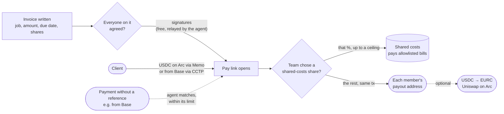

<div align="center">


# Keyarc

**Your team's payment link, on Arc.**

Clients pay one link. Everyone on the invoice agrees to their share first,<br/>
and when the money lands each share goes straight to its owner's wallet, in the same transaction.

[**Live app**](https://keyarc.app) · [Demo team](https://keyarc.app/c/0xd5e487c52C504903cf89121f2BBC01D938a3c4B4) · [Contracts](contracts/src) · [Agent](agent/src) · [Mainnet addresses](deployments/arc-mainnet.json)


</div>

---

## Contents

- [The problem](#the-problem)
- [Who it is for](#who-it-is-for)
- [What Keyarc does](#what-keyarc-does)
- [How a payment moves](#how-a-payment-moves)
- [The treasury agent](#the-treasury-agent)
- [Live on Arc mainnet](#live-on-arc-mainnet)
- [Why Arc](#why-arc)
- [Security model](#security-model)
- [Repository map](#repository-map)
- [Run it locally](#run-it-locally)
- [For reviewers](#for-reviewers)
- [Status and roadmap](#status-and-roadmap)

## The problem

Small teams that bill clients together (a developer in İstanbul, a designer in Berlin, a copywriter in Lisbon) almost always get paid the same way: **the client pays one person, and that person forwards everyone's share by hand.**

That person becomes the team's bank. On paper the whole payment is their income, so they carry the tax and trust risk for money that isn't theirs. Teammates wait and ask ("has the client paid yet?"). Partial transfers go missing ("you sent 1,000, where's the rest?"). Shares get argued about after the money has landed. Shared tools get paid out of one person's pocket.

## Who it is for

Teams whose clients can pay in USDC, which in 2026 is a lot of clients:

- **Agencies and freelance teams with clients abroad.** A Shopify store can take its sales in USDC on Base and keep them as USDC; a startup in Dubai or Singapore pays contractors in USDC to skip wires. The team in İstanbul wants dollars, not a SWIFT fee and a week of waiting.
- **Crypto-native work.** Protocols, DAOs and grant programs pay contributors in USDC already, and usually to one wallet.
- **Any team that bills together often**, so "who forwards what" is a monthly chore, not a one-off.

## What Keyarc does

Keyarc replaces "pay me and I'll forward it" with **a payment link backed by a contract that belongs to the whole team.**

| | Today | With Keyarc |
|---|---|---|
| Who receives the money | One member's wallet | The team's chest (a contract), which passes it straight on |
| When shares are decided | After the money arrives | On the invoice, **agreed by everyone on it** before the client can pay |
| When people are paid | Whenever the collector forwards it | **In the same transaction the client pays** |
| Where each share lands | Wherever the collector sends it | Each member picks their own payout address |
| Shared tools and hosting | Out of someone's pocket | Optional: the team can set a share aside for them (off by default) |
| Late payers | Someone remembers to chase | The agent drafts the reminder when the invoice is past due |
| Changing the rules | Whoever holds the wallet | Member vote + timelock |

**The flow in the app** (`/app/bill`):

1. Write what the team delivered, the amount, the due date, and who did the work with their share.
2. The first invoice opens the team's chest; later invoices take one signature.
3. Everyone else on the invoice opens the link and **agrees to their share with a free signature** (EIP-712; the agent carries it to the chest and pays the gas).
4. Send the same link to the client. They pay in USDC **on Arc** or **from Base** (CCTP fast transfer). No account and no Keyarc token.
5. The shares go out in the payment transaction. The client gets a receipt; each member sees their earnings across teams (`/app/earnings`), exports them as CSV or PDF, and can convert USDC to **EURC on Arc** in one step.

**How it differs from a splitter or an invoicing tool.** A payment splitter fixes one split per address; an invoicing tool pays into one account. Keyarc's split is per invoice (each job has its own people and shares), it has to be agreed by those people before the client can pay, and an agent does the collections work around it.

## How a payment moves



- **Agreed, not just written down.** Every contributor except the invoice's author must agree before `payInvoice` or `settleInvoice` work (`AwaitingApproval`). They agree on chain (`approveInvoice`) or by signing the invoice's terms, which anyone may submit (`approveInvoiceFor`). The signature covers the chest, the chain, the invoice id, the amount, the payer, the due date, the shared-costs share and every share.
- **Paid on the spot.** The shares go out in the payment transaction. The last contributor takes the rounding remainder, so nothing is left behind but the shared-costs share the team chose.
- **One member can't block a payout.** If a transfer fails (for example a USDC blocklist), everyone else is still paid and the failed share is held for `claim(to)`.
- **Invoice ids can't be squatted.** An id is `keccak(chest, creator, salt)`, and payment must match the expected amount.
- **On Arc** the client approves exactly the invoice amount and pays through Arc's **Memo** contract, so the invoice id sits in Arc's own memo log while the payer stays `msg.sender`.
- **From Base** the client burns USDC with **CCTP v2 fast transfer**, with the chest as mint recipient. The agent relays Circle's attestation, matches the inflow to the invoice and settles it; the shares go out in that transaction.

## The treasury agent

A Cloudflare Worker that does the team's collections and bookkeeping. For anything that needs judgement it asks **Claude Haiku 5.5** (`claude-haiku-5-5`) with structured outputs. **The model reads and gives an opinion; code decides; the contract sets the limits.**

| Job | What it does | What must be true before money moves |
|---|---|---|
| **Carries agreements** | Takes a contributor's signed agreement from the pay page and submits it, paying the gas. | The call is simulated first; the chest checks the signature itself. |
| **Collections** | Watches USDC that reaches the chest without a reference (a Base payment, a plain transfer) and matches it to an open invoice. | Exactly one open invoice is paid by it (exact amount, at most 0.5% over), **and** everyone on it agreed, **and** the model agrees with ≥ 80% confidence, **and** the amount is within the monthly limit, **and** the funds are in the chest. Over the limit → a vote. Otherwise → **held** for members. |
| **Overdue reminders** | Once an invoice is past its due date, drafts a reminder in the team's language with the pay link and puts it in the agent panel, ready to send by WhatsApp or email. Again every few days while it stays unpaid. | Nothing is sent by the agent. Amount, due date and job come from the chain; the link is appended by code. |
| **Payables** | Reads supplier bills (email or upload, PDFs included), screens them for fraud, pays them from shared costs. | Supplier is in the members' registry; currency is right; amount ≤ supplier max and ≤ 3× their usual bill; invoice number never paid before; payment details unchanged; no pressure or hidden instructions; payee allowlisted on chain; within the limit; covered by the shared-costs share. Any fraud signal → refused. |
| **Cross-chain** | Relays CCTP burns from Base to Arc. | Circle's attested message must name this chest as mint recipient and Arc (domain 26) as destination. |
| **Weekly note** | Income, what was paid out, whether the shared-costs share covers the bills; at most one suggestion. | Only a suggestion. Members adopt it with one click, which opens a rules vote. |

**Bounds enforced by the contract, whatever the agent or the model says:**

- It cannot set anyone's share: an invoice the agent writes needs every contributor's agreement.
- It pays bills only to addresses members allowlisted by vote (`isPayee`), and only from the shared-costs reserve.
- Matching and spending are capped per 30 days (`autoAttributeCap`, `expenseCapPerPeriod`).
- Every agent action carries a single-use reference (`RefRequired`, `RefAlreadyUsed`): the inflow's tx hash, or the keccak seal of the decision record, so each on-chain action points back to a decision anyone can inspect.
- It cannot change rules, add members or release the reserve. The only votes it may propose are attribution, expense and invoice-settlement votes.
- The model never supplies an address. Payees come from the supplier registry and amounts are checked against fixed ranges.

Every decision is stored with its facts, each check and its result, the model's reading, the outcome and the transaction hash, and is shown in the chest's agent panel. Without an API key the agent runs **rules-only** and holds anything that needs judgement.

**Running mode.** A cron trigger runs every minute, one chest per run (Workers Free allows 50 subrequests per invocation). Every chest that chose "let the treasury agent collect for us" is picked up on first contact, without a redeploy.

## Live on Arc mainnet

| | Address |
|---|---|
| CollectiveFactory (v4) | [`0x8FFAa9227Ab19456bb5a4fCf51C1515f7906a811`](https://explorer.arc.io/address/0x8FFAa9227Ab19456bb5a4fCf51C1515f7906a811) |
| Collective implementation (v4) | [`0x46561f701bc73c914BcdD1Fb58E307DcC5258278`](https://explorer.arc.io/address/0x46561f701bc73c914BcdD1Fb58E307DcC5258278) |
| Demo team · Keyarc Studio | [`0xd5e487c52C504903cf89121f2BBC01D938a3c4B4`](https://explorer.arc.io/address/0xd5e487c52C504903cf89121f2BBC01D938a3c4B4) |
| Treasury agent | [`0xBB682c02E3429d808499c1Ec5414b34113A21017`](https://explorer.arc.io/address/0xBB682c02E3429d808499c1Ec5414b34113A21017) |
| USDC → EURC router (Uniswap) | [`0x53BF6B0684Ec7eF91e1387Da3D1a1769bC5A6F77`](https://explorer.arc.io/address/0x53BF6B0684Ec7eF91e1387Da3D1a1769bC5A6F77) |

**End-to-end proof on mainnet** (proof chest [`0x09987bc4Ac66992935bDb8B9ff2A7A7F0980F318`](https://explorer.arc.io/address/0x09987bc4Ac66992935bDb8B9ff2A7A7F0980F318), reproducible with [`agent/scripts/mainnet-setup.ts`](agent/scripts/mainnet-setup.ts)):

1. A 0.10 USDC invoice is written for two people, 70 / 30 ([tx](https://explorer.arc.io/tx/0xdeae1a5d2a7ac0b5165b4a71742a8389fa8c418c5a0379edf85bdf89b156dc8e)).
2. The second person agrees by signature; someone else submits it ([tx](https://explorer.arc.io/tx/0xc2690d60ecb4a91a2096172afb950ce412df6278f364341afae26eb120ef06a5)).
3. The client pays through Arc Memo, and in that same transaction 0.01 USDC goes to shared costs, 0.063 and 0.027 USDC to the two wallets ([tx](https://explorer.arc.io/tx/0xc55fed847bbfc1854c56a654071d0b7803dbabf2a85f35771ddb3e5fdea29fe6)).
4. A member converts 0.10 USDC to 0.089163 EURC on Arc ([swap tx](https://explorer.arc.io/tx/0xcd1ed40e2d8604a400f5cfe02b9d334febafad3e13bc306005f3092038a44fd4)).

Earlier versions (v1 to v3) and every hash are in [`deployments/arc-mainnet.json`](deployments/arc-mainnet.json). The demo team's members are the author's own wallets; it is a demonstration, not customer activity.

## Why Arc

- **USDC is the gas token.** Clients, members and the agent hold one asset. Nobody buys a second token to pay fees.
- **Memo.** The invoice reference lives in Arc's native payment memo log, and the payer is still `msg.sender`.
- **CCTP v2.** A client on Base pays a team on Arc in about a minute, with no bridge to trust and no wrapped token.
- **EURC next to USDC.** A member in Europe takes their share in euros without leaving the chain.
- **Deterministic finality.** A payout is final when the receipt says so.

## Security model

- **Invariant-tested accounting.** Across random sequences of invoices, payments, attributions, bills and blocked recipients, every USDC the chest holds equals `reserve + owed + unattributed`, and everything paid in reached the members (or is owed to them) except the shared-costs share ([`Invariant.t.sol`](contracts/test/Invariant.t.sol)).
- **Agreement before payment** ([`Approvals.t.sol`](contracts/test/Approvals.t.sol)): an invoice can't be paid or settled until everyone on it agreed; a signature is bound to its invoice, chest and chain, and the digest matches an independent EIP-712 implementation (`vm.eip712HashTypedData`), which is what wallets sign.
- **Findings pinned by tests** ([`Hardening.t.sol`](contracts/test/Hardening.t.sol), [`Payouts.t.sol`](contracts/test/Payouts.t.sol)):
  - I1: proposals expire, keep the quorum they were made under, and die when membership changes; proposers can cancel and voters can unvote.
  - I2: quorum must be over half, the timelock has a floor, and a two-member team needs both votes.
  - I3: the agent's limits reset per window, not per call.
  - I4: invoice ids can't be squatted and payment must match the expected amount.
  - I5: released shared-costs money goes only to the recipients named in the vote.
  - I6 (v4 review): the shared-costs share is fixed when the invoice is written and is part of what people sign, so a later rules vote can't take more of an agreed invoice; payout addresses can't be the chest or the token.
- **Agent bounds live in the contract, not in the prompt.** A stolen agent key can do no more than its limits allow, only towards allowlisted addresses, and can't assign shares ([`AgentGuards.t.sol`](contracts/test/AgentGuards.t.sol)).
- **Known limits, accepted.** Within its monthly limit, the agent together with one member can route money that arrived without a reference to an invoice that member wrote for themself; around a window boundary it can use two windows' limits back to back. Both need the agent key and stay inside the caps members set.
- **Prompt-injection resistant payables.** Bills are untrusted input: the model flags pressure and hidden instructions, and it never chooses a payee or an amount.
- **Signed configuration.** Changes to the agent's supplier registry, inbox, on-demand runs and reminder drafts must be signed by a current member within the last 10 minutes.
- **No open door to the free tier.** The unsigned writes are bounded: a payment note only for open invoices of a managed chest, at most three times each; an agreement only after the call simulates successfully.
- **Exact-amount approvals only.** The app never asks for an open-ended allowance.

## Repository map

```
contracts/   Solidity 0.8.28 · Foundry · OpenZeppelin v5
  src/Collective.sol           invoices, agreement (EIP-712), payout on payment, shared costs, governance, agent bounds
  src/CollectiveFactory.sol    minimal-proxy clones, one transaction per team
  test/                        12 suites, 93 tests, incl. invariant, approvals and hardening

agent/       Cloudflare Worker · KV · email handler · Claude Haiku 5.5
  src/index.ts                 HTTP API, agreement relay, signed member requests, the per-chest cycle
  src/collections.ts           inflow scanning (budgeted per pass), open-invoice index, invoice matching
  src/reminders.ts             overdue and on-request payment reminders
  src/payables.ts              supplier registry, bill screening, payment from shared costs
  src/cctp.ts                  Base → Arc attestation relay
  src/treasury.ts              weekly note
  src/llm.ts                   model judge (structured output) + rules-only fallback
  src/log.ts                   sealed decision records
  src/logindex.ts              a chest's whole event history in one request (keyless Arc getLogs workaround)
  scripts/mainnet-setup.ts     demo team + end-to-end proof on mainnet

web/         Vite · React 19 · TypeScript strict · wagmi · viem · GSAP
  src/routes/Landing.tsx       the story (workshop board, scroll scenes)
  src/app/Bill.tsx             invoice-first flow: opens the chest behind the first invoice
  src/app/Pay.tsx              client pay page, agreement, receipt (Arc Memo) · PayFromBase.tsx (CCTP)
  src/app/Agree.tsx            sign your share; the agent carries it, or agree on chain
  src/app/Earnings.tsx         earnings across teams by job, CSV/PDF, payout address, USDC → EURC
  src/app/Chest.tsx            members, rules, paid out, shared costs, invoices, votes, agent panel
  functions/rpc.ts             Pages Function RPC relay with provider fallback

deployments/arc-mainnet.json   every address and proof transaction
```

## Run it locally

```bash
# contracts
cd contracts && forge test

# agent
cd agent && bun install && bun test
bunx wrangler dev        # needs AGENT_PRIVATE_KEY; ANTHROPIC_API_KEY optional (rules-only without it)

# web
cd web && bun install && bun run dev    # http://localhost:5180
                                         # add ?mock=1 on a chest page for sample agent decisions (labelled as such)
```

## For reviewers

Shortest path to checking the claims above:

| Claim | Where to verify |
|---|---|
| Everyone on an invoice agrees before it can be paid | `createInvoice`, `approveInvoiceFor`, `payInvoice` in [`Collective.sol`](contracts/src/Collective.sol), [`Approvals.t.sol`](contracts/test/Approvals.t.sol) |
| Shares go out in the payment transaction | `_payShares` in [`Collective.sol`](contracts/src/Collective.sol), [`Payouts.t.sol`](contracts/test/Payouts.t.sol), the proof's pay tx above |
| The shared-costs share is optional and pays only allowlisted bills | [`Expenses.t.sol`](contracts/test/Expenses.t.sol), `test_noReserveWhenTheTeamDidNotAskForOne` |
| One failed transfer doesn't block the rest | `_payOut` / `claim`, `test_blocklistedMemberDoesNotBlockOthers` |
| Members choose their payout address | `setPayoutAddress`, [`PayoutAddress.t.sol`](contracts/test/PayoutAddress.t.sol) |
| The agent can't exceed its limits | [`AgentGuards.t.sol`](contracts/test/AgentGuards.t.sol), [`Expenses.t.sol`](contracts/test/Expenses.t.sol), [`Attribution.t.sol`](contracts/test/Attribution.t.sol) |
| The model can't move money on its own | [`collections.ts`](agent/src/collections.ts), [`payables.ts`](agent/src/payables.ts), [`collections.test.ts`](agent/src/collections.test.ts), [`payables.test.ts`](agent/src/payables.test.ts) |
| The agent chases late invoices | [`reminders.ts`](agent/src/reminders.ts), [`reminders.test.ts`](agent/src/reminders.test.ts) |
| It works on mainnet | the transactions under [Live on Arc mainnet](#live-on-arc-mainnet) |

## Status and roadmap

**Live:** contracts v4 on Arc mainnet (agreement before payment, payout on payment, optional shared costs), the invoice-first app with receipts, pay from Arc or Base, earnings by job with payout addresses and USDC → EURC, the treasury agent on Claude Haiku 5.5 running every minute (agreements, collections, overdue reminders, bills).

**Next:**

- **Joining without a wallet.** Invite a teammate by link and give them a Circle wallet, instead of asking for an Arc address up front.
- **Agent identity.** Move the agent's key to a Circle developer-controlled wallet and register it in Arc's ERC-8004 registry.
- **More source chains** on the pay page through CCTP.
- **Contributor reputation** built from paid invoices.

## License

[MIT](LICENSE)
